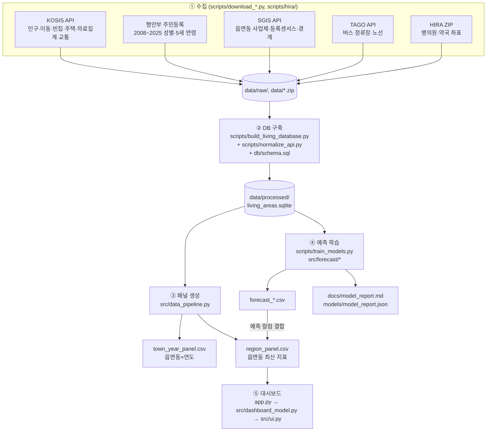

# 전북 생활권 인사이트 (JBLivingTemperature)

전북 읍면동 242곳의 **현재 생활 여건**(대중교통·의료·사업체·청년·주거)을 비교하고, **3년 뒤 청년 인구와 사업체 쇠퇴 위험을 예측**해
공인된 기준(지방소멸위험지수, 도시재생법 쇠퇴 기준)으로 위험 단계를 보여 주는 Streamlit 대시보드입니다.

이 README 하나로 프로젝트의 목적, 데이터 흐름, 폴더·파일별 역할, 실행 방법을 모두 파악할 수 있도록 정리했습니다.
세부 내용은 각 절에 연결한 `docs/` 문서에 있습니다.

---

## 목차

1. [프로젝트 개요](#1-프로젝트-개요)
2. [빠른 실행](#2-빠른-실행)
3. [전체 데이터 흐름](#3-전체-데이터-흐름)
4. [폴더 구조](#4-폴더-구조)
5. [파일별 상세 설명](#5-파일별-상세-설명)
6. [데이터 원천과 DB](#6-데이터-원천과-db)
7. [생활 점수와 위험 단계 계산 방식](#7-생활-점수와-위험-단계-계산-방식)
8. [예측 모델](#8-예측-모델)
9. [생성되는 결과 파일](#9-생성되는-결과-파일)
10. [테스트](#10-테스트)
11. [문서 안내](#11-문서-안내)
12. [작업 규칙과 주의 사항](#12-작업-규칙과-주의-사항)
13. [한계와 남은 과제](#13-한계와-남은-과제)

---

## 1. 프로젝트 개요

### 무엇을 하는가

| 기능 | 설명 |
| --- | --- |
| 지역 선택 | 사이드바에서 시군 → 읍면동 2단계로 선택 |
| 상단 카드 | 생활 점수, 상대 등급(A~E), 3년 후 청년 인구 변화(80% 예측구간), 3년 감소 위험 단계 |
| 지도 | 읍면동 대표점을 '생활 점수 등급' 또는 '3년 감소 위험' 색으로 표시 |
| 3년 내 감소 위험 표 | 청년 인구(현재→예측), 지방소멸위험지수(현재→예측), 예상 청년 순이동, 사업체 쇠퇴(도시재생법 기준), 먼저 쇠퇴할 업종 |
| 예측 요인 | 청년 예측·업종 위험에 크게 작용한 요인(SHAP) |
| 추천 지역 | 사용자가 정한 가중치로 계산한 생활 점수 상위 5곳과 추천 이유 문장 |
| 핵심 지표 표 | 인구, 청년·고령 비율, 정류장·노선·의료기관·사업체 수 등 |

### 핵심 원칙

- **분석 단위**: SGIS 2024년 경계 기준 전북 읍면동 **242곳**입니다. 금암1·2동은 금암동으로 합치고, 2025년 신설된 송천3동은 송천1동에 포함합니다.
- **공인 기준 우선**: 위험 단계는 자체 기준이 아니라 한국고용정보원 **지방소멸위험지수**와 **도시재생법 시행령 제17조** 산업 쇠퇴 기준을 씁니다. 남아 있는 자체 기준은 문서에 표시해 둡니다.
- **상대 비교**: 생활 점수는 절대 수준이 아니라 "전북 읍면동 중 어느 정도 위치인가"를 나타내는 백분위 기반 점수입니다.
- **출처 추적**: 모든 원천 파일은 DB 안에 경로·출처·SHA-256으로 기록되어, 어떤 숫자가 어디서 왔는지 따라갈 수 있습니다.
- **시군 단위 자료**: 빈집 비율과 시군 청년 순이동은 시군 단위 자료라서 같은 시군의 읍면동에는 같은 값이 들어갑니다.

---

## 2. 빠른 실행

> 자세한 설치, 인증키 발급, 전체 데이터 수집 절차, 문제 해결 방법은 **[실행 매뉴얼](docs/실행_매뉴얼.md)**에 있습니다.

### 준비물

- Python 3.11 이상
- Node.js 18 이상 (HIRA 병의원 ZIP을 새로 받을 때만 필요)

### 이미 만들어진 DB 파일이 있을 때 (약 3분)

`data/`는 용량(약 800MB)과 인증키 문제로 Git에 올리지 않습니다. 팀원에게 아래 두 파일을 받아 같은 경로에 두세요.

- `data/processed/living_areas.sqlite` (원천 DB, 약 210MB)
- `data/raw/sgis/boundary_town_2024.json` (읍면동 경계)

```bash
# 1) 가상환경과 패키지
python3 -m venv --system-site-packages .venv
.venv/bin/python -m pip install -r requirements.txt

# 2) 예측 모델 학습 + 보고서 + 대시보드 데이터 생성 (약 1분, 마지막에 "done: 242 towns")
.venv/bin/python scripts/train_models.py

# 3) 대시보드 실행 → http://localhost:8501
.venv/bin/python -m streamlit run app.py --server.address 127.0.0.1 --server.port 8501
```

서버에서 실행했다면 VS Code의 **Ports** 탭에서 8501번을 전달해서 접속합니다.
`--system-site-packages`로 가상환경을 만들면 `streamlit` 명령이 `.venv/bin`에 생기지 않을 수 있으니, 항상 `.venv/bin/python -m streamlit` 형태로 실행합니다.

### 처음부터 데이터를 모두 받을 때 (약 1시간 30분)

```bash
cp .env.example .env        # KOSIS / 공공데이터포털 / SGIS 인증키 입력
# 원천 다운로드 (scripts/download_*.py, scripts/hira/download.js) → 실행 매뉴얼 B-2 참고
.venv/bin/python scripts/build_living_database.py   # 원천 DB 구축 (약 3분)
.venv/bin/python scripts/train_models.py            # 예측 + 대시보드 데이터
.venv/bin/python -m streamlit run app.py
```

---

## 3. 전체 데이터 흐름

프로젝트는 **수집 → DB 구축 → 패널 생성 → 예측 학습 → 대시보드**의 5단계 파이프라인입니다.
각 단계는 앞 단계의 결과 파일만 읽기 때문에, 바꾼 부분부터 다시 실행하면 됩니다.



| 단계 | 실행 명령 | 입력 | 출력 |
| --- | --- | --- | --- |
| ① 수집 | `scripts/download_*.py`, `node scripts/hira/download.js` | 인증키(`.env`) | `data/raw/**`, `data/*.zip` |
| ② DB 구축 | `scripts/build_living_database.py` | `data/raw/**`, `data/*.zip`, `docs/*출처.xlsx` | `data/processed/living_areas.sqlite` |
| ③ 패널 생성 | `scripts/build_dataset.py` (또는 ④에서 자동 실행) | SQLite DB | `region_panel.csv`, `town_year_panel.csv`, `data_quality.json` |
| ④ 예측 학습 | `scripts/train_models.py` | SQLite DB | `forecast_*.csv`, 보고서, 그리고 ③ 재실행 |
| ⑤ 대시보드 | `streamlit run app.py` | `region_panel.csv`, `data_quality.json` | 웹 화면 |

앱은 `region_panel.csv`가 없거나 DB보다 오래되었으면 DB에서 패널을 자동으로 다시 만듭니다.
이때는 예측 CSV가 있으면 함께 붙이고, 없으면 "예측 결과가 연결되지 않았습니다" 안내를 띄운 뒤 최근 인구 추세로 대신 계산합니다.

---

## 4. 폴더 구조

```
JBLivingTemperature/
├── app.py                         # Streamlit 진입점 (데이터 로드 → 점수 계산 → 화면 렌더링)
├── requirements.txt               # 파이썬 패키지 목록
├── .env.example                   # 인증키 템플릿 (복사해서 .env로 사용, .env는 Git 제외)
├── .gitignore                     # data/, .env, .venv/, node_modules/ 등 제외
│
├── src/                           # 앱과 모델이 공유하는 파이썬 패키지
│   ├── data_pipeline.py           # DB → 읍면동 단위·연도 패널·대시보드 패널 생성
│   ├── dashboard_model.py         # 생활 점수, 등급, 위험 단계, 추천 스냅샷 계산
│   ├── ui.py                      # Streamlit 화면 구성 (사이드바, 카드, 표, 차트)
│   ├── forecast/                  # 예측 모델
│   │   ├── data.py                # 모델 공통 입력 (연령대별 인구, 업종별 사업체 등)
│   │   ├── youth.py               # 청년 순이동 추정 + 청년 인구 3년 예측
│   │   └── business.py            # 도시재생법 기준 사업체 쇠퇴 위험 예측
│   ├── recommendation/
│   │   └── explanation.py         # 추천 지역의 이유 문장 생성
│   └── visualization/
│       └── map.py                 # Folium 지도 (등급/위험 색상, 팝업)
│
├── scripts/                       # 커맨드라인으로 실행하는 수집·빌드·학습 스크립트
│   ├── download_mois_population.py  # 행안부 주민등록 연령별 인구 (키 불필요)
│   ├── download_kosis_api.py        # KOSIS 통계표 (인구·이동·빈집·주택·사업체 2020)
│   ├── download_hira_quarterly.py   # KOSIS HIRA 시군구 의료기관 분기 집계
│   ├── download_transport_api.py    # KOSIS 대중교통 접근수단·시간·이용횟수
│   ├── download_sgis_api.py         # SGIS 읍면동 사업체·등록센서스 인구·경계
│   ├── download_tago_api.py         # TAGO 버스 정류장·노선·노선별 정류장
│   ├── hira/                        # HIRA 병의원·약국 ZIP 다운로드 (Node + Playwright)
│   │   ├── download.js
│   │   └── package.json, package-lock.json
│   ├── normalize_api.py             # API 응답(JSON)을 타입 있는 SQLite 테이블로 적재
│   ├── build_living_database.py     # 원천 SQLite DB 구축 (+ 무결성 검사)
│   ├── build_dataset.py             # 대시보드 패널만 다시 생성
│   ├── train_models.py              # 예측 학습·백테스트·보고서·패널 갱신 (메인 파이프라인)
│   └── evaluate_holdout.py          # 2/3 학습·1/3 평가 홀드아웃 검증 (보조 검증)
│
├── db/
│   └── schema.sql                 # SQLite 테이블·뷰 정의 (29개 테이블, 10개 뷰)
│
├── models/                        # 모델 메타데이터와 성능 지표 (모델 파일 자체는 저장 안 함)
│   ├── metadata.json              # 모델 이름·버전·구성 설명
│   ├── model_report.json          # train_models.py가 쓰는 백테스트 성능 지표
│   └── holdout_report.json        # evaluate_holdout.py 결과
│
├── tests/                         # pytest 테스트
│   ├── test_data_pipeline.py
│   ├── test_dashboard_model.py
│   ├── test_forecast.py
│   └── test_ui.py
│
├── docs/                          # 프로젝트 문서 (11. 문서 안내 참고)
│
└── data/                          # ⚠ Git 제외. 원천 데이터와 생성 결과
    ├── 전국 병의원 및 약국 현황 *.zip   # HIRA ZIP 8개
    ├── raw/
    │   ├── kosis_api/             # KOSIS API 응답 JSON
    │   ├── mois/                  # 행안부 주민등록 CSV (2008~2025)
    │   ├── sgis/                  # SGIS 사업체·인구 JSON, 시군·읍면동 경계
    │   └── tago/                  # TAGO 정류장·노선 JSON (시군별)
    └── processed/
        ├── living_areas.sqlite    # 원천 DB
        ├── town_year_panel.csv    # 읍면동×연도 패널
        ├── region_panel.csv       # 대시보드 입력 (읍면동 242행)
        ├── data_quality.json      # 출처·경고 메타데이터
        ├── youth_net_migration.csv
        ├── forecast_youth.csv
        ├── forecast_business_town.csv
        ├── forecast_business_sector.csv
        └── business_sector_ranking.csv
```

---

## 5. 파일별 상세 설명

### 5-1. 앱 (`app.py`, `src/`)

앱이 실행되는 순서는 다음과 같습니다.

```
app.py
 ├─ load_dashboard_data()        ← src/data_pipeline.py   (region_panel.csv 읽기 또는 DB에서 재생성)
 ├─ render_sidebar()             ← src/ui.py              (지역 선택, 지도 색상, 가중치 슬라이더)
 ├─ build_dashboard_snapshot()   ← src/dashboard_model.py (점수·등급·위험 단계·추천 계산)
 │    └─ generate_reason()       ← src/recommendation/explanation.py
 └─ render_dashboard()           ← src/ui.py
      └─ create_folium_map()     ← src/visualization/map.py
```

#### `app.py`
Streamlit 진입점입니다. 데이터를 `st.cache_data`로 캐시해서 불러오고, 사이드바 입력을 받아 스냅샷을 만든 뒤 화면을 그립니다.
필수 데이터가 없으면 오류 메시지를 띄우고 멈춥니다.

#### `src/data_pipeline.py` — DB를 분석 단위 패널로 바꾸는 모듈
- `load_units()`: SGIS 2024 읍면동 경계에서 분석 단위 242곳(코드·시군·읍면동·면적·대표점 좌표)을 만듭니다.
- 행정구역 변경 처리
  - `TOWN_RENAMES`: 이름이 바뀐 읍면동을 현재 이름으로 맞춥니다. 예: 용진면 → 용진읍
  - `TOWN_MERGES`: 금암1·2동은 금암동으로, 송천3동은 송천1동으로 합칩니다.
  - `BOUNDARY_RESETS`: 경계 조정으로 과거 주민등록 인구와 비교할 수 없는 동을 지정합니다. 예: 2018년 혁신동 신설, 2023년 여의동→혁신동 편입. 이런 동은 SGIS 등록센서스 변화율로 대신 계산합니다.
- `build_town_year_panel()`: 읍면동×연도 패널을 만듭니다. 항목은 인구, 청년·고령, 20~39세 여성, 지방소멸위험지수, 등록센서스, 사업체·종사자, 시군 빈집·순이동입니다.
- `build_region_panel()`: 최신 연도 지표, 5년 변화율, 정류장·노선·의료기관 수, 정류장 밀도를 계산하고 데이터 품질 경고를 모읍니다.
- `_attach_forecasts()`: `forecast_youth.csv`, `forecast_business_town.csv`가 있으면 예측 컬럼을 붙입니다. 어떤 컬럼을 어떤 이름으로 붙이는지는 `FORECAST_COLUMNS`에 정의되어 있습니다.
- `write_processed()` / `load_dashboard_data()`: CSV·JSON을 저장하고 읽습니다. DB가 패널보다 새로우면 패널을 다시 만듭니다.

#### `src/dashboard_model.py` — 점수와 위험 단계
- `DEFAULT_WEIGHTS`: 6개 항목의 기본 가중치입니다. 교통 3, 의료 3, 사업체 2, 빈집 1, 청년 1, 미래 안정성 1입니다.
- `score_regions()`: 항목별 백분위 점수, 가중합 생활 점수, A~E 등급, 지방소멸 단계, 사업체 단계, 종합 위험 단계를 계산합니다. 자세한 내용은 [7절](#7-생활-점수와-위험-단계-계산-방식)에 있습니다.
- `build_dashboard_snapshot()`: 화면에 필요한 정보를 하나의 딕셔너리로 묶습니다. 선택 지역, 항목별 기여도, 추천 상위 5곳, 품질 정보, 안내 문구가 들어갑니다.
- 기준값 상수: `EXTINCTION_TIERS`, `BUSINESS_WATCH_PROBABILITY`(0.5), `SMALL_TOWN_ESTABLISHMENTS`(200)

#### `src/ui.py` — 화면
- `inject_styles()`: 공통 CSS를 넣습니다.
- `render_sidebar()`: 시군→읍면동 선택, 지도 색상 모드, 6개 가중치 슬라이더를 그립니다.
- `build_status_cards()`, `build_forecast_rows()`: 카드와 위험 표에 들어갈 데이터를 만듭니다. 화면 렌더링과 분리되어 있어 테스트할 수 있습니다.
- `render_dashboard()`: 카드, 지도, 위험 표, 예측 요인(Plotly), 추천, 핵심 지표, 출처·경고를 그립니다.

#### `src/visualization/map.py`
Folium 지도를 만듭니다. 등급 색(`GRADE_COLORS`)이나 위험 단계 색(`STAGE_COLORS`)으로 읍면동 대표점을 칠하고, 팝업에 주요 지표를 보여 줍니다.
**좌표는 분석값이 아니라 읍면동 경계 안의 대표점**입니다. 배경 타일(OpenStreetMap)을 보려면 인터넷 연결이 필요합니다.

#### `src/recommendation/explanation.py`
항목 백분위가 75 이상(상위 25%)인 강점을 골라 "대중교통, 의료기관 수가 상위권" 같은 추천 이유 문장을 만듭니다.

### 5-2. 예측 모델 (`src/forecast/`)

#### `src/forecast/data.py`
모델들이 같이 쓰는 입력 `ForecastInputs`를 DB에서 만듭니다. 들어가는 것은 읍면동 목록, 5세 연령대 인구, 여성 연령대 인구, 연도 패널, 업종별 사업체, 시군 의료기관 수입니다.
**각 기준연도의 피처는 그 해와 이전 해의 값만 쓰도록** 만들어서 미래 정보가 섞이지 않게 했습니다.

#### `src/forecast/youth.py` — 청년(20~39세)
- `cohort_net_migration()`: 코호트 잔차법으로 순이동을 추정합니다. 5년 전 15~34세 인구와 올해 20~39세 인구를 비교하는 방식입니다.
- `hamilton_perry()`, `hamilton_perry_elderly()`: 인구학 기준선인 해밀턴-페리 코호트 추계입니다. 청년과 65세 이상에 각각 씁니다.
- `build_dataset()` / `backtest()`: 읍면동×기준연도 패널로 시간 순서 백테스트를 합니다. 비교하는 방법은 `no_change`, `trend_3y`, `aging_only`, `hamilton_perry`, `lgbm_direct`, `lgbm_residual`입니다.
- `conformal_widths()`: 인구 규모별 80% 예측구간을 계산합니다.
- `shap_drivers()`: 읍면동별로 예측에 크게 작용한 요인을 뽑습니다.
- `forecast()`: 최종 3년 예측을 냅니다. 청년 인구, 변화율, 예측구간, 순이동, 지방소멸위험지수 예측이 포함됩니다.

#### `src/forecast/business.py` — 사업체 쇠퇴
- `statutory_status()`: 도시재생법 기준 해당 여부를 판정합니다. 기준은 최근 5년 최고치 대비 5% 이상 감소, 또는 3년 이상 연속 감소입니다.
- `SectorHistory`: 읍면동 전체(`total=True`)나 읍면동×업종(사업체 10개 이상)의 연도별 사업체 이력입니다.
- `build_dataset()` / `backtest()`: 1년 내·3년 내 해당 여부를 예측합니다. LightGBM과 로지스틱 회귀를 쓰고, 기준선과 비교합니다.
- `add_calibrated()`: 백테스트 점수로 확률을 보정합니다(Platt).
- `town_summary()`, `province_ranking()`: 읍면동별로 먼저 쇠퇴할 업종과 전북 업종 순위를 계산합니다.

### 5-3. 스크립트 (`scripts/`)

| 스크립트 | 하는 일 | 필요한 키 | 소요 시간 |
| --- | --- | --- | --- |
| `download_mois_population.py` | 행안부 주민등록 5세·성별 인구 CSV (2008~) | 없음 | 약 2분 |
| `download_kosis_api.py --table <이름>` | KOSIS 통계표 JSON. `registered_population`, `migration_age`, `migration_sex`, `migration_rate`, `business_town`, `vacant_housing`, `housing_types` | `KOSIS_API_KEY` | 합계 약 5분 |
| `download_hira_quarterly.py` | 시군구 의료기관 분기 집계 (2009~) | `KOSIS_API_KEY` | |
| `download_transport_api.py` | 전북 대중교통 접근·이용 (2014~2024) | `KOSIS_API_KEY` | |
| `download_sgis_api.py` | 읍면동 사업체 2000~2024, 등록센서스 2015~2024, 경계 | `SGIS_CONSUMER_KEY/SECRET` | 약 15분 |
| `download_tago_api.py --dataset all` | 버스 정류장·노선·노선별 정류장 스냅샷 | `DATA_GO_KR_API_KEY` | 약 45분 |
| `hira/download.js` | HIRA 병의원·약국 ZIP. 헤드리스 크롬으로 다운로드 | 없음 | ZIP 8개, 약 500MB |
| `build_living_database.py` | 원천 파일 → SQLite DB. 임시 DB에 먼저 만들고 무결성 검사를 통과해야 교체 | | 약 3분 |
| `normalize_api.py` | DB 빌더가 불러 쓰는 모듈. API JSON 정규화, 정류장·의료기관 좌표를 읍면동 경계에 배정 | | |
| `build_dataset.py` | 대시보드 패널만 다시 생성 (예측은 다시 돌리지 않음) | | 수 초 |
| `train_models.py` | **메인 학습 파이프라인**. 아래 4단계 실행 | | 약 1분 |
| `evaluate_holdout.py` | 무작위·시간순·엠바고 분할로 2/3 학습, 1/3 평가 → `models/holdout_report.json` | | |

다운로드 스크립트는 모두 **이미 받은 파일은 건너뛰고**, `--force`를 붙이면 다시 받습니다.

`train_models.py`가 실행하는 4단계:

1. 청년 순이동 추정 (코호트 잔차법, KOSIS 실제값과 비교 검증) → `youth_net_migration.csv`
2. 사업체 쇠퇴 위험 (전체·업종별, 1년·3년) → `forecast_business_town.csv`, `forecast_business_sector.csv`, `business_sector_ranking.csv`
3. 청년 인구 3년 예측 (백테스트로 방법 선택) → `forecast_youth.csv`
4. 성능 지표·보고서 작성(`models/model_report.json`, `docs/model_report.md`)과 대시보드 패널 갱신

### 5-4. DB 스키마 (`db/schema.sql`)

테이블은 성격에 따라 다음과 같이 나뉩니다.

| 분류 | 테이블 |
| --- | --- |
| 출처 추적 | `catalog_item`, `source_file`, `catalog_source_file`, `api_record`, `data_issue` |
| 인구 | `historical_population_age`(KOSIS 2001~2007), `area_year`, `population_age`, `population_age_female`(행안부 2008~), `sgis_population_town`(등록센서스) |
| 인구 이동 | `migration_annual_count`, `migration_annual_rate`, `migration_observation` |
| 사업체 | `sgis_business_town`(2000~2024 읍면동×업종), `business_2020`(경제총조사) |
| 주거 | `vacant_housing`, `housing_type_area_annual`, `province_housing_observation` |
| 의료 | `medical_facility_snapshot`, `medical_facility_admin`(좌표→읍면동), `medical_city_quarterly`, `province_medical_summary` |
| 교통 | `tago_stop`, `tago_route`, `tago_route_stop`, `tago_stop_admin`(좌표→읍면동), `bus_stop`(기존 전국 CSV), `province_transport_api`, `province_transport_observation` |

뷰(view)는 자주 쓰는 집계를 미리 정의해 둔 것입니다. 예: `city_population_series`, `city_age20_39_net_migration`, `sgis_business_city_annual`, `tago_stop_admin_city_counts`

### 5-5. 설정·기타 파일

| 파일 | 설명 |
| --- | --- |
| `.env.example` | `KOSIS_API_KEY`, `DATA_GO_KR_API_KEY`, `SGIS_CONSUMER_KEY`, `SGIS_CONSUMER_SECRET` |
| `requirements.txt` | pandas, geopandas, scikit-learn, lightgbm, shap, streamlit, streamlit-folium, folium, plotly, pyproj, shapely, openpyxl, PyYAML, pytest |
| `models/metadata.json` | 모델 버전(현재 0.3.0)과 각 모델 설명 |
| `.continue/agents/new-config.yaml` | 개인용 로컬 코딩 에이전트(Continue + Ollama) 설정. 프로젝트 실행과 무관 |

---

## 6. 데이터 원천과 DB

| 자료 | 원천 | 범위 | 단위 |
| --- | --- | --- | --- |
| 주민등록 인구 (성별·5세 연령대) | 행안부 / KOSIS | 2008~2025 / 2001~2007 | 읍면동 / 시군 |
| 등록센서스 인구 (현재 경계) | SGIS | 2015~2024 | 읍면동 |
| 사업체·종사자 (산업 대분류) | SGIS 전국사업체조사 | 2000~2024 | 읍면동 |
| 전입·전출·순이동, 이동률 | KOSIS | 2001~2025 | 시군 |
| 빈집, 주택 유형 | KOSIS | 2015~2025 | 시군 (주택 유형 일부 읍면동) |
| 병의원·약국 좌표 | HIRA 공개 ZIP | 2023.12~2026.6 스냅샷 | 시설 → 읍면동 배정 |
| 의료기관 분기 집계 | KOSIS(HIRA) | 2009~2026 | 시군 |
| 버스 정류장·노선 | TAGO | 현재 스냅샷 | 정류장 → 읍면동 배정 |
| 대중교통 접근·이용 | KOSIS | 2014~2024 | 전북 전체 |

**데이터를 해석할 때 꼭 알아야 할 점**
- 사업체 수는 **2019→2020년에 조사 기준이 바뀌면서 53% 늘었습니다**. 그래서 이 구간을 넘는 증감률은 만들지 않고, 도시재생법의 "10년 최고치" 기준도 5년으로 줄여서 적용합니다.
- 산업분류가 2005년까지는 KSIC 8차(D=제조업), 2006년부터는 9차 이후(C=제조업)입니다.
- TAGO에는 완주군 피드가 없습니다. 그래서 전주·임실·익산 피드에 섞여 있는 완주군 정류장을 좌표로 분리해서 씁니다. 정류장 수는 방향별 승강장 ID 수라서 실제 물리적 정류장 수보다 많습니다.
- 버스 데이터는 과거 이력이 없고, 의료 데이터는 읍면동 이력이 짧아서 예측 모델에는 넣지 않았습니다. 현재 상태 지표로만 씁니다.

전체 원천 목록, 원본 링크 검증 결과, 품질 문제는 **[DB 구축 상태](docs/database.md)**와 **[데이터셋 정리](docs/data.md)**에 있습니다.

---

## 7. 생활 점수와 위험 단계 계산 방식

### 생활 점수 (0~100, 자체 기준)

각 항목을 **242개 읍면동 안에서의 백분위 순위(0~100)**로 바꾼 뒤, 사용자 가중치로 가중평균합니다.

| 항목 | 기본 가중치 | 구성 |
| --- | --- | --- |
| 대중교통 접근성 | 3 | 정류장 밀도(개/km²) 50% + 경유 노선 수 50% |
| 의료 접근성 | 3 | 의료기관 수 |
| 생활 인프라(사업체) | 2 | 사업체 수 |
| 주거 안정성(시군) | 1 | 시군 빈집 비율 (낮을수록 좋음) |
| 청년 기반 | 1 | 20~39세 비율 50% + 청년 5년 변화율 50% |
| 미래 안정성(3년 예측) | 1 | 청년 3년 예측 변화율 50% + 사업체 1년 쇠퇴 확률 50% (낮을수록 좋음). 예측이 없으면 5년 인구 변화 60% + 고령 비율 40% |

**상대 등급 A~E**는 생활 점수의 백분위를 5분위로 나눈 것입니다.

### 3년 감소 위험 단계 (안정 / 주의 / 위험)

| 대상 | 기준 | 단계 |
| --- | --- | --- |
| 청년 | **지방소멸위험지수** = 20~39세 여성 ÷ 65세 이상 (한국고용정보원). 3년 뒤 예측값 사용 | 0.5 미만 위험, 0.5~1.0 주의, 1.0 이상 안정 |
| 사업체 | **도시재생법 시행령 제17조**: 최근 최고치 대비 5% 이상 감소 또는 3년 이상 연속 감소 | 이미 해당하면 위험, 1년 안에 해당할 확률 50% 이상이면 주의, 사업체 200개 미만이면 위험(**자체 기준**) |
| 종합 | 두 단계 중 더 나쁜 쪽 | |

기준을 정한 근거와 학술적 비판, 자체 기준을 둔 이유는 [서비스 명세](docs/서비스_명세.md#판단-기준과-출처)에 있습니다.

---

## 8. 예측 모델

| 예측 | 방법 | 검증 결과 (시간 순서 백테스트) |
| --- | --- | --- |
| 청년 순이동 추정 | 코호트 잔차법 | 시군 합계가 KOSIS 실제 순이동과 상관 0.996 |
| 청년 인구 3년 예측 | LightGBM 패널 회귀(Huber 손실). 해밀턴-페리·추세 유지 등과 비교해 선택. 80% 예측구간, SHAP 요인 | 인구가중 오차 8.7%p (해밀턴-페리 10.8%p) |
| 지방소멸위험지수 3년 예측 | 20~39세 여성은 청년 예측 변화율 적용, 65세 이상은 해밀턴-페리 추계 | 65세 이상 5년 검증 오차: 전북 합계 +0.07% |
| 사업체 쇠퇴 (읍면동 전체) | LightGBM + 로지스틱 평균, Platt 확률 보정 | 1년 ROC-AUC 0.84 (현재 상태 유지 0.79), 3년 내 0.74 (0.71) |
| 먼저 쇠퇴할 업종 | 같은 기준을 읍면동×업종에 적용 | 1년 ROC-AUC 0.81, 3년 내 0.75 |

- 학습된 모델 파일은 저장하지 않습니다. `train_models.py`를 실행할 때마다 다시 학습합니다(약 1분).
- SHAP은 **예측에 대한 기여도**이지 인과 효과가 아닙니다.
- 최신 결과와 읍면동별 상위 목록은 [예측 모델 결과 보고서](docs/model_report.md)에 있습니다. 이 보고서는 `train_models.py`가 자동으로 생성합니다.

---

## 9. 생성되는 결과 파일

모두 `data/processed/` 아래에 생기고 Git에는 올라가지 않습니다. 예외로 `docs/model_report.md`와 `models/*.json`은 Git에 포함됩니다.

| 파일 | 만드는 곳 | 내용 |
| --- | --- | --- |
| `living_areas.sqlite` | `build_living_database.py` | 원천 DB |
| `town_year_panel.csv` | `data_pipeline.write_processed` | 읍면동×연도: 인구, 청년·고령, 20~39 여성, 지방소멸위험지수, 등록센서스, 사업체, 시군 빈집·순이동 |
| `region_panel.csv` | `data_pipeline.write_processed` | 읍면동 242행. 최신 지표, 인프라 수, 예측 컬럼(`youth_forecast_*`, `business_*`, `first_risk_*` 등) |
| `data_quality.json` | `data_pipeline.write_processed` | 각 지표의 출처·기준연도, 데이터 경고 |
| `youth_net_migration.csv` | `train_models.py` 1단계 | 읍면동별 5년 구간 청년 순이동 추정 |
| `forecast_business_town.csv` | `train_models.py` 2단계 | 읍면동 사업체 쇠퇴 기준 해당 여부, 1·3년 확률, 먼저 쇠퇴할 업종 |
| `forecast_business_sector.csv` | `train_models.py` 2단계 | 읍면동×업종별 확률 |
| `business_sector_ranking.csv` | `train_models.py` 2단계 | 전북 업종별 쇠퇴 위험 순위 |
| `forecast_youth.csv` | `train_models.py` 3단계 | 3년 뒤 청년 인구, 변화율, 80% 구간, 순이동, 지방소멸위험지수 예측, SHAP 요인 |

---

## 10. 테스트

```bash
.venv/bin/python -m pytest -q tests
```

| 파일 | 대상 |
| --- | --- |
| `test_data_pipeline.py` | 이름 변경·병합, 경계 조정 의심 탐지, 242행 패널, 시군 합계 일치, 등록센서스 대체 범위 |
| `test_dashboard_model.py` | 백분위 방향·결측 처리, 가중치 반영, A~E 5분위, 위험 단계 기준값, 예측 유무에 따른 미래 안정성 |
| `test_forecast.py` | 코호트 순이동, 해밀턴-페리, 조사기준 단절 구간 회피, 도시재생법 기준 판정 |
| `test_ui.py` | 숫자 포맷, 상단 카드, 예측 미연결 안내, 위험 표 구성 |

DB가 없으면 DB가 필요한 테스트는 자동으로 건너뜁니다.

---

## 11. 문서 안내

| 문서 | 언제 읽나 |
| --- | --- |
| [docs/실행_매뉴얼.md](docs/실행_매뉴얼.md) | 설치, 인증키, 전체 구축, 시연 순서, 문제 해결 |
| [docs/서비스_명세.md](docs/서비스_명세.md) | 지금 구현된 기능, 판단 기준과 출처, 기획서와 달라진 점, 변경 이력 |
| [docs/model_report.md](docs/model_report.md) | 모델 성능, 백테스트 표, 읍면동별 예측 결과 (자동 생성) |
| [docs/database.md](docs/database.md) | 원천 데이터 범위, 테이블 매핑, 원본 링크 검증, 남은 원천 과제 |
| [docs/data.md](docs/data.md) | 카테고리별 원천 데이터셋 상세 정리 |
| `docs/전북 생활권 에이전트 서비스 기획서.pdf` | 최초 서비스 기획서 |
| `docs/전북_생활권_에이전트_데이터_다운로드_출처.xlsx` | 원천 데이터 출처 목록. DB 빌더가 이 파일을 읽어 카탈로그를 만듦 |
| [docs/2026-08-19.md](docs/2026-08-19.md) | 초기 MVP 작업 기록 (현재 구조와 다른 부분 있음) |
| `docs/superpowers/` | 2026-09 대시보드 리디자인 설계(spec)와 구현 계획(plan) |

---

## 12. 작업 규칙과 주의 사항

- **기능이나 기준을 바꾸면** [서비스 명세](docs/서비스_명세.md)를 함께 고치고, 문서 안의 '변경 이력'에 남깁니다.
- **모델 코드를 바꾸면** `train_models.py`를 다시 실행해서 `docs/model_report.md`와 `models/model_report.json`도 같이 커밋합니다.
- **인증키와 `data/`는 절대 커밋하지 않습니다.** `.gitignore`가 막고 있지만, `git add -f`는 쓰지 마세요.
- 명령은 모두 **프로젝트 루트**에서 실행합니다. 스크립트가 `ROOT` 기준 경로를 씁니다.
- 새 데이터를 반영하는 순서: 다운로드 → `build_living_database.py` → `train_models.py`. 자세한 내용은 [실행 매뉴얼의 "데이터를 새로 고칠 때"](docs/실행_매뉴얼.md#데이터를-새로-고칠-때)를 보세요.
- 행정구역 변경(분동·합동·이름 변경)이 생기면 `src/data_pipeline.py`의 `TOWN_RENAMES`, `TOWN_MERGES`, `BOUNDARY_RESETS`를 갱신합니다. 패널 생성 때 `data_quality.json`에 경계 조정 의심 경고가 나오면 이 부분부터 확인하세요.

---

## 13. 한계와 남은 과제

**현재 한계**
- 생활 점수와 A~E 등급은 자체 기준(상대 순위)입니다.
- 의료·대중교통은 감소 예측 없이 현재 상태만 반영합니다.
- 30분 생활시설 접근성은 KTDB 2025.3 평일 시간표·OSM 2026.10 보행망으로 행정복지센터에서 출발해 병의원·약국(HIRA 2025.3)과 대형마트·슈퍼·편의점·음식점·카페·학교·도서관·영화관·경로당(공공데이터, [개선기능 실행](docs/개선기능_실행.md#생활시설-병의원약국-외))에 닿는지 추정합니다. 236곳을 계산하고 센터 위치 미확인 5곳·보행망 미연결 1곳은 결측으로 표시합니다. 주말·실시간·일자리 접근성은 제공하지 않습니다. 기존 생활 점수는 정류장·노선 수 기준을 유지합니다.
- 빈집 비율과 청년 순이동(현재 지표)은 시군 단위입니다.

**남은 과제** (자세한 내용은 [서비스 명세](docs/서비스_명세.md#남은-과제))
1. 30분 생활권 검증·확장: 미확인 행정복지센터 위치 확인, 보행 연결 구간 검증, 최신·주말 시각표 확보
2. 인프라 관계 분석 확장: 현재 사업체·빈집 패널의 유의한 결과가 없어 기존 가중치 유지. 연도별 교통·의료 이력 및 통제 변수 확보
3. 생활권 에이전트: 자동차 보유·연령·선호 지역 조건 입력, 정책 담당자 모드
4. 생활 점수 등급을 공인 기준이나 분석 결과로 대체할지 검토
5. TAGO 정기 수집 시작 (교통 감소 예측에 쓸 이력 확보)


개선 기능의 구현 범위, 데이터 준비 및 실행 방법: [30분 생활권·인프라 관계 분석·교통 이력 수집](docs/개선기능_실행.md).
